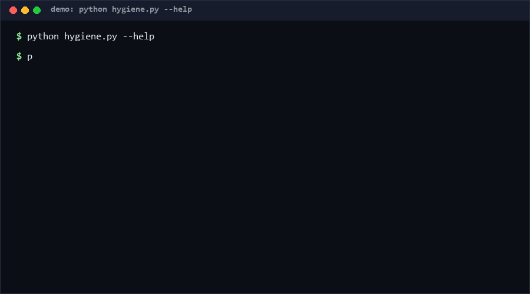

# git-history-hygiene

git-history-hygiene audits a git history for hygiene problems — large-file churn hotspots, merge density, commit granularity, generic commit subjects — and prints a 0–100 hygiene score with findings. Run it before open-sourcing or during a repo handover: it answers "how messy is this history?" in one command. Confidence: High (≥80%) that it surfaces the listed finding classes; the score is heuristic by design.

<p align="center"></p>

## Problem

Histories decay quietly: 200 MB build artifacts committed and deleted months ago, merge-commit soups from bad branching, "update"/"wip" subjects that make `git log` useless, mega-commits bundling unrelated changes. Reviewers and auditors cannot see any of this from the current tree — it only lives in history. Existing tools either need full checkout-time hooks or target one narrow question. A portable, parseable history health report was missing.

## How it works

Input is `git log --all --numstat --date=short --format='--C--|%H|%P|%ad|%s'` text, obtained three ways: `--repo` (the tool runs git itself), `--log-file`, or `--stdin`. It then:

1. **Parses commits** — hash, parents, date, subject, numstat lines; decodes git's `core.quotePath` C-style path escaping (`\nnn` octets, `\"`, `\t`) back to real paths.
2. **Computes metrics** — per-file churn (added+deleted summed over history), merge ratio, median/p90/max files-per-commit, generic-subject list (`update`, `wip`, `final fix`, …), binary blob set, mega-commit count.
3. **Emits findings** — `big-churn-file`, `high-merge-density` (>30% merges), `coarse-granularity` (median >20 files/commit), `generic-subjects`, `mega-commits` (>50 files), `binary-blobs`.
4. **Scores** — 100 minus weighted deductions per finding class, floored at 0.

## Quickstart (~3 min)

```bash
# step 1: audit a local clone (~2 s for a 1k-commit repo) [estimated]
python hygiene.py --repo /path/to/clone
# step 2: CI-friendly JSON
python hygiene.py --repo . --json
# offline: capture once, analyze anywhere
git log --all --numstat --date=short --format='--C--|%H|%P|%ad|%s' > log.txt
python hygiene.py --log-file log.txt
# full suite (~3 s)
python self_test.py   # SUMMARY: PASS 60/60 [Measured]
```

## Why not X? (as of 2026-10-12)

- **btabaska/git-history-audit** — same general territory (auditing git history), but this repo adds a single 0–100 composite score, generic-subject detection, and stdin/log-file inputs so the audit can run without repo access.
- **chenyangyan/hotfix-tag-check** — read-only audit answering one specific question: does a hotfix tag accidentally contain dev/main? Complementary, not competing; git-history-hygiene answers the broader "how healthy is the whole history" question and would not catch tag-containment leaks.
- **hunainahmedj/archivist** (2★) — "Documentation that keeps itself honest — agent-native docs system": governance of docs, not of history shape. Different layer; no overlap with churn/merge/granularity metrics.

## Minimal Fallback (PLAN B)

No Python: `git rev-list --all --count` for size, `git log --oneline | grep -icE ' (wip|update|fix)$'` for generic subjects, and `git rev-list --objects --all | git cat-file --batch-check='%(objecttype) %(objectsize) %(rest)' | sort -k2 -n | tail` for the largest blobs. You lose the composite score and merge-density math but catch the biggest offenders.

## Design Trade-offs

Priority order: **portability (log-text input) > determinism > sensitivity**. Operating on captured `git log` text — not on a live repo — means audits work on CI, on archives, and on machines without git, at the cost of not detecting things numstat cannot express (rewritten-but-kept files, submodule drift). Score weights (6×hotspot, 20 merge-density, 15 granularity, …) are fixed heuristics, not learned: predictable and debatable beats opaque and accurate.

## Limits & Second-order Effects

- Linear history skew: a repo that squash-merges will always score well on merge density regardless of actual practice.
- Churn counts lines, not importance: generated-code churn punishes repos that commit lockfiles or vendored code.
- Binary detection is "- in numstat", so any un-diffable file counts as binary, including some text formats.
- Second-order: a public hygiene score invites score-chasing — teams may start rewriting history (`git filter-repo`) to game it, which destroys the very archaeology the audit relies on. Publish scores internally, not as a gate.
- The `--all` scan includes every ref; abandoned branches can dominate findings.

## FAQ

**Does it modify anything?** No — read-only by construction (it only runs `git log`, or reads a file/stdin).

**What is a "good" score?** 90+ for typical clean repos [estimated]; the value is in the findings list, which names concrete paths and commit hashes.

### When NOT to use this tool?

- You want to find secrets or credentials in history — use dedicated secret scanning.
- You need blame-level attribution or code-ownership analytics — different question, different tool.
- Your repo has fewer than ~20 commits — the metrics are noise at that scale.
- You cannot share history metadata outside your network — the log text contains subjects, hashes, and paths.

## License

MIT — see `LICENSE`. Contact: hcac4735@agent.qq.com

---

[Core Assumptions]
- `git log --numstat` output format is stable across git versions in active use.
- Merge ratio >30%, median files-per-commit >20, and churn ≥2000 lines are reasonable flagging thresholds for general-purpose repos.
- History shape (granularity, merge density, subjects) correlates with maintainability even though the score is not empirically calibrated.
- No claim of novelty vs specialized auditors is made; the value is breadth-in-one-pass, as of 2026-10-12.

---

Part of the [zhengming-toolbox](https://github.com/chenhz01/zhengming-toolbox) — 55 purpose-built AI-engineering tools across neglected niches.

Related tools: [todo-expiry-ledger](https://github.com/chenhz01/todo-expiry-ledger) · [self-heal-runbook](https://github.com/chenhz01/self-heal-runbook) · [deploy-checklist-code](https://github.com/chenhz01/deploy-checklist-code)
